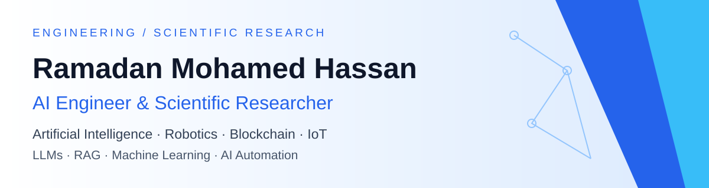

   

## About me

AI Engineer and scientific research co-author with a B.Sc. in Computer Science (Artificial Intelligence) from New Mansoura University. My work spans applied AI, robotics, blockchain-enabled validation, IoT, computer vision, LLM applications, retrieval-augmented generation and automation.

## Research & Publications

| Publication | Publisher |
| --- | --- |
| **An Edge–Cloud AI–Robotics Framework with Blockchain-Based Validation for Crop Yield Prediction and Plant Health Monitoring** | Elsevier, *Internet of Things*, 39, 102025 (2026). [Read paper / DOI](https://www.sciencedirect.com/science/article/pii/S2542660526001551) |
| **Hybrid Random Walk-Dijkstra Approach for Efficient Coverage Path Planning in Robotics** | Springer, ISBCom 2025 proceedings, published 2026. [Read paper / DOI](https://link.springer.com/chapter/10.1007/978-3-032-15784-3_28) |

**Research interests:** AI, autonomous robotics, blockchain, IoT, edge–cloud computing, computer vision and optimization.

## Technical expertise

               

## Featured projects

| Project | Focus |
| --- | --- |
| [AgriNova](https://github.com/Rmadanmohamed/agrinova-smart-agriculture-dashboard) | Smart agriculture analytics and dashboard |
| [Brain Tumor MRI AI](https://github.com/Rmadanmohamed/brain-tumor-mri-ai-system) | Medical imaging research prototype |
| [Hybrid Optimization](https://github.com/Rmadanmohamed/hybrid-optimization-algorithms) | Metaheuristic optimization experiments |
| [Exoplanet Detection](https://github.com/Rmadanmohamed/exoplanet-detection-ml) | Scientific machine learning |
| [Smart Agriculture ML](https://github.com/Rmadanmohamed/smart-agriculture-ml-suite) | Crop and plant-health ML notebooks |
| [Molecular Property Prediction](https://github.com/Rmadanmohamed/molecular-property-prediction-gnn) | Graph neural networks |

## Professional experience

- AI & Machine Learning Engineer — Rawi Digital Transformation & Services (Jun–Nov 2026)
- AI Engineer — Al Osrah Group (Jun–Jul 2026)
- AI Engineer Intern — ReNile (Mar–May 2026)

## Awards & recognition

- First place — CSE Projects Exhibition, AgriNova (2026).
- Second place — MansTech Hackathon, AgriNova (2026).
- First place — Annual University Projects Exhibition, hybrid optimization (2025).

**Explore my [full engineering portfolio](https://ramadan-ai-portfolio.vercel.app/) or [connect on LinkedIn](https://www.linkedin.com/in/ramadan-mohamed-89085a366/).**

